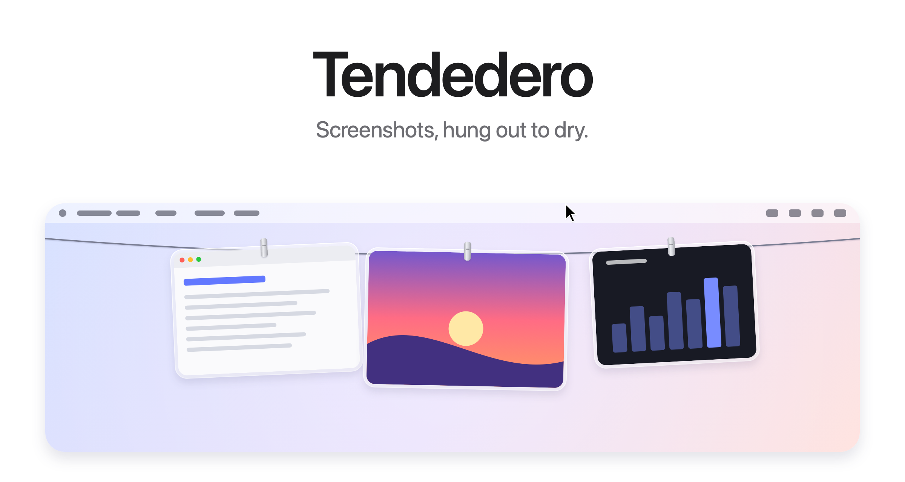

# 晾衣线 · 个人定制版

基于 [Alejandro Buján 的 Tendedero](https://github.com/alejandrobujan/tendedero) 修改的 macOS 桌面截图与文字便签工具。本仓库用于个人私有备份，以下原版介绍保留作来源参考，不代表本定制版的全部行为。

## 当前定制功能

- 截图与文字便签单排悬挂，自动缩放，悬停放大。
- 原图造型便签、文字自动换行、小锤子新建便签和固定展开按钮。
- 沿晾衣线拖动调整顺序，自动保存，支持撤销；拖到其他应用仍可复制。
- 图片直接拖入、待上绳队列、图钉保护、最近收起和撤销。
- 收起保留原文件，明确删除才移入废纸篓。
- `Option + Shift + A` 展开或收起，`Option + Shift + N` 新建文字便签。

仓库仅包含源码、构建脚本和界面素材，不包含个人截图、便签文字、登录凭据或编译产物。

## 本仓库构建

```sh
git clone https://github.com/hzhu9367-debug/liangyixian.git
cd liangyixian
scripts/build-app.sh
open build/Tendedero.app
```

需要 macOS 14 或以上及 Swift 工具链。

## 来源与素材许可

原作者版权与 MIT 源码许可保留在 [LICENSE](LICENSE)。原项目名称、图标及文档图片不包含在 MIT 源码授权中；公开发布修改版前，须依原作者要求更换应用名称和图标。新增便签参考素材仅作个人使用，公开分发前应确认相应图片权利。

---

## 原项目说明

<picture>
  <source media="(prefers-color-scheme: dark)" srcset="docs/hero-dark.png">
  
</picture>

<p align="center">
  Free and open source. For macOS 14 and later.
  <br>
  <a href="../../releases/latest">Download&nbsp;&rsaquo;</a>
  &nbsp;&nbsp;
  <a href="#build-from-source">Build from source&nbsp;&rsaquo;</a>
</p>

<br>

## Out of sight. Within reach.

Every screenshot you take hangs on a line just above your screen.
Rest the pointer in the menu bar and it glides down. Move away and it's gone.

<picture>
  <source media="(prefers-color-scheme: dark)" srcset="docs/demo-dark.gif">
  
</picture>

<br>
<br>

## A gesture for everything.

<picture>
  <source media="(prefers-color-scheme: dark)" srcset="docs/bento-dark.png">
  
</picture>

<br>
<br>

| | |
|:--|:--|
| Click | Copy the image. |
| Press and hold | Open it in Markup. |
| Double click | Open it in Preview. |
| Drag into an app | Send a copy. It stays on the line. |
| Drag into a folder | Keep it there. It leaves the line. |
| Click the pin | Protect an item from replacement. |
| Click the minus | Take it down while keeping its file. |
| Choose Move to Trash | Delete the file explicitly. |
| Rest the pointer in the menu bar | Bring the line down on that screen. |
| Click anything in the menu bar | Put it away. |
| <kbd>⌥</kbd>&thinsp;<kbd>⇧</kbd>&thinsp;<kbd>A</kbd> | Show or hide the line. |
| <kbd>⌥</kbd>&thinsp;<kbd>⇧</kbd>&thinsp;<kbd>N</kbd> | Create a text note. |
| <kbd>⌘</kbd>&thinsp;<kbd>Z</kbd> | Undo a take-down, deletion or replacement. |

<br>

## Your Desktop. Finally clear.

Hand Tendedero your screenshots<sup>1</sup> and they skip the Desktop
entirely. No floating thumbnail. No five-second wait. Each capture hangs
the instant you take it, and only what you drag out is kept.

Same shortcuts. Same muscle memory. Just less mess.

<br>

## Private by design.

No account. No network. No analytics.
Tendedero runs entirely on your Mac, and your screenshots never leave it.

<br>

## Tech Specs

| | |
|:--|:--|
| **Compatibility** | macOS 14 Sonoma or later, on Apple silicon and Intel. Designed for macOS 27. |
| **Size** | 1.7 MB |
| **Languages** | English, Spanish |
| **Built with** | Swift, AppKit and SwiftUI |
| **Network access** | None |
| **Price** | Free |
| **License** | MIT for the code. The name and icon are not included. |

<br>

## Install

Download the disk image from the [latest release](../../releases/latest),
open it and drag Tendedero to Applications.

Tendedero is not notarized by Apple yet, so the first time macOS will say it
cannot verify it. Open System Settings, go to Privacy & Security, and click
Open Anyway next to the message about Tendedero. You only need to do this once.

<br>

## Build from source

```sh
git clone git@github.com:alejandrobujan/tendedero.git
cd tendedero
scripts/build-app.sh
open build/Tendedero.app
```

Requires the Swift toolchain. Xcode is optional. With the Command Line Tools for macOS 27, the script falls back to the macOS 26 SDK they install alongside, because the new SDK needs a SwiftUI macro plugin only Xcode includes. Local builds are signed ad hoc,
so macOS asks again for access to the Desktop after each rebuild.

<details>
<summary>Inside the app</summary>
<br>

| File | Role |
|:--|:--|
| `AppDelegate.swift` | Menu bar, shortcut, revealing and tucking away the line |
| `LinePanel.swift` | The transparent strip along the top of the screen |
| `LineView.swift` | The line and where each photo hangs |
| `PeggedView.swift` | One photo: glass frame, clip, swing and breeze |
| `GrabArea.swift` | Click, long press, drag and drop |
| `ScreenshotWatcher.swift` | Notices new screenshots |
| `Inbox.swift` | Takes over screenshot settings and puts them back |
| `Markup.swift` | Opens the system Markup editor and saves the result |
| `FullScreen.swift` | Knows when to stay hidden |
| `Line.swift` | What is hanging, and what you can do with it |

Every image here, the icon included, is drawn in code by
`scripts/make-icon.swift` and `scripts/make-readme-art.swift`.
`scripts/make-dmg.sh` builds the disk image for releases.

</details>

<br>

---

<sub>
1. On first launch, Tendedero offers to handle your screenshots. If you accept, it turns off the floating thumbnail and saves new screenshots to its own folder, two settings also found under Options in Cmd+Shift+5. Your previous settings are saved and restored when Tendedero quits or the option is turned off from the menu bar. Tendedero hides automatically while an app is in full screen.
</sub>

<br>
<br>

<p align="center">
  
  <br>
  <sub>The code is MIT licensed. The Tendedero name and icon are not, so forks need their own. See <a href="LICENSE">LICENSE</a>.</sub>
  <br>
  <sub>Designed and built by <a href="https://alejandrobujan.com">Alejandro Buján</a>.</sub>
</p>
